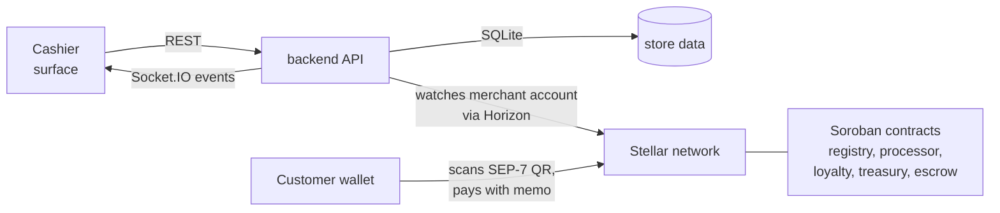

# StellarPOS

**Open-source point of sale for shops that take payment on Stellar.** Cashiers
ring up sales, take cash, card, or a Stellar QR payment in any mix, and the
sale completes by itself when the payment lands on-chain. No keys on the
server, no copying transaction hashes, no "did it go through?".


## The three repositories

| Repository | What it is | Stack |
|---|---|---|
| [**surface**](https://github.com/StellarPOS-App/surface) | The point-of-sale app: register, checkout, orders, stock, customers, reports, settings | React 18, TypeScript, Vite, Tailwind, TanStack Query |
| [**backend**](https://github.com/StellarPOS-App/backend) | REST + WebSocket API, plus the watcher that settles Stellar payments | Node.js 22, Express, embedded SQLite (`node:sqlite`), Socket.IO |
| [**contracts**](https://github.com/StellarPOS-App/contracts) | On-chain settlement, loyalty, multisig treasury, and escrow | Rust, Soroban SDK 27 |

## How it fits together



1. The cashier rings up a sale. The backend reserves the stock and prices
   the cart.
2. For a Stellar payment, the app shows a
   [SEP-0007](https://github.com/stellar/stellar-protocol/blob/master/ecosystem/sep-0007.md)
   QR with the amount and a unique memo.
3. The customer pays from any Stellar wallet. The backend sees the payment
   on Horizon, checks the account, the asset (code **and** issuer), the
   amount and the memo, and completes the sale.
4. Every terminal in the shop updates live.

The backend only watches the merchant's **public** key. Customer funds go
straight to the merchant's own account.

## Try it locally

```bash
# 1. API (http://localhost:3000)
git clone https://github.com/StellarPOS-App/backend.git && cd backend
npm install && cp .env.example .env    # set JWT_SECRET (openssl rand -hex 32)
npm run db:seed && npm run dev

# 2. App (http://localhost:5173), in another terminal
git clone https://github.com/StellarPOS-App/surface.git && cd surface
npm install && npm run dev
```

Sign in as `admin@stellarpos.dev` with password `stellarpos-demo`. To take
real testnet payments, set `STELLAR_MERCHANT_PUBLIC_KEY` in the backend's
`.env` to a funded testnet account.

Contracts:
`git clone https://github.com/StellarPOS-App/contracts.git && cd contracts && make test`,
then `make deploy` to deploy the full suite to testnet.

## Contributing

We welcome contributions of every size. Start with
[CONTRIBUTING.md](https://github.com/StellarPOS-App/.github/blob/main/CONTRIBUTING.md),
then browse the open issues in
[surface](https://github.com/StellarPOS-App/surface/issues),
[backend](https://github.com/StellarPOS-App/backend/issues) and
[contracts](https://github.com/StellarPOS-App/contracts/issues).

Report security issues privately. See
[SECURITY.md](https://github.com/StellarPOS-App/.github/blob/main/SECURITY.md).

All projects are [MIT licensed](https://github.com/StellarPOS-App/surface/blob/main/LICENSE).
